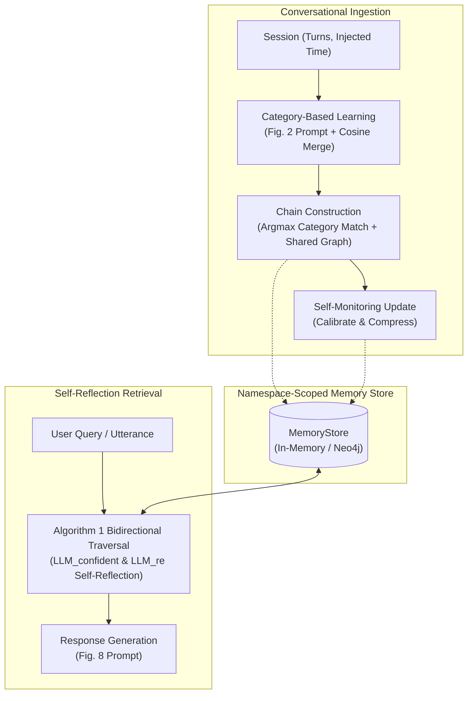

# M4 Architecture & Public Interface Documentation

## 1. System Overview

**M4 (Meta-Memory for Memory Management)** provides a cognitive, self-reflective long-term memory layer for Large Language Models based on *"Meta-Memory for Large Language Models"* (Liang et al., IEEE TASLP, vol. 34, 2026).



## 2. Ports and Adapters (Clean Architecture)

- **`LLMClient`:** Pluggable interface for chat models (Ollama, vLLM, OpenAI-compatible).
- **`Embedder`:** Dense embedding interface (`bge-small-en-v1.5`, `all-minilm`, etc.).
- **`MemoryStore`:** Graph storage interface scoped by `namespace` (`InMemoryMemoryStore` for high-speed benchmark runs and unit tests; `Neo4jMemoryStore` for production graph deployments).
- **`Compressor`:** Token compressor interface (e.g. LLMLingua).
- **`Observer`:** Telemetry hook recording token counts, LLM calls, latency, and events.

## 3. Plug M4 into Any Chatbot (20-Line Example)

```python
from datetime import datetime, timezone
from m4 import M4Memory, M4Config, Session, Turn
from m4.adapters import OllamaLLMClient, OllamaEmbedder, InMemoryMemoryStore

# 1. Initialize M4 engine with desired adapters and config
mem = M4Memory(
    config=M4Config(gamma=0.5, temperature=0.8),
    llm=OllamaLLMClient(base_url="http://localhost:11434", model="qwen2.5:7b-instruct"),
    embedder=OllamaEmbedder(base_url="http://localhost:11434", model="bge-small-en-v1.5"),
    store=InMemoryMemoryStore(),
)

# 2. Ingest dialogue sessions into the user's namespace
user_ns = "user_12345"
mem.ingest_session(user_ns, Session(
    id="sess_01",
    turns=[Turn(speaker="User", text="I adopted a golden retriever named Charlie."),
           Turn(speaker="Assistant", text="Congratulations! Charlie is a wonderful name.")],
    timestamp=datetime(2025, 5, 1, 10, 0, tzinfo=timezone.utc),
))

# 3. Respond to user queries with cognitive retrieval & self-reflection
response = mem.respond(user_ns, "What breed is my dog?")
print("Assistant:", response.text)
# Output: "Your dog Charlie is a golden retriever."
```

## 4. Public API Methods

| Method | Parameters | Return Value | Description |
|---|---|---|---|
| `ingest_session` | `namespace: str, session: Session` | `IngestReport` | Ingests multi-turn dialogue, extracts category clues, builds chains, and calibrates conflicts. |
| `retrieve` | `namespace: str, query: str, dialogue_context: str | None` | `RetrievalResult` | Performs Algorithm 1 self-reflective bidirectional chain search. |
| `respond` | `namespace: str, query: str, dialogue_context: str | None` | `Response` | Retrieves contributory memories and synthesizes a fluent, coherent answer. |
| `maintain` | `namespace: str, now: datetime` | `int` | Runs iterative LLMLingua compression with LLM recoverability check on dormant nodes. |
| `reset` | `namespace: str` | `None` | Clears all stored memories and chains for the given namespace. |
| `stats` | `namespace: str` | `StoreStats` | Returns node counts, category counts, chain counts, and shared node statistics. |
